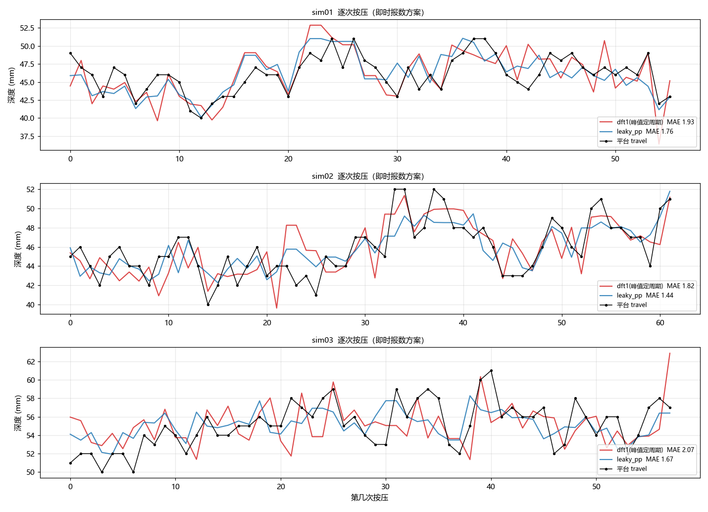
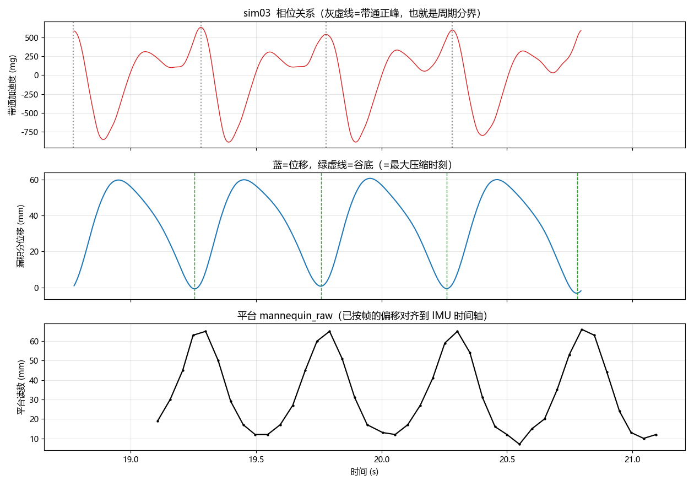

# 还有没有别的办法 —— 实时（因果）条件下的方法对比

> 约束：
> 1. **传感器是逐样本来的**，不能拿整段数据回头算 → 只能用因果滤波（`lfilter`），不能用 `filtfilt`、不能用全段 FFT
> 2. **每次按压结束就要给这一次的深度**（延迟预算 0 ~ 2 个周期，见第 6 节）
>
> 脚本：`realtime_eval.py`（逐次评估）、`budget.py`（延迟预算扫描）、`leaky_sweep.py`（时间常数）、`phase.py`（相位/延迟）、`absint.py`（绝对深度可行性）
>
> **结论先行**：换"信号形态"（漏积分两次 → 位移 → 取峰谷差）比换任何频谱算法都值，逐次就有 **1.61 mm**；允许晚 1 个周期再叠 2 点平均到 **1.52 mm**。详见第 2、6 节。

---

## 0. 先剪枝：哪些方法在实时条件下直接出局

| 方法 | 离线效果 | 实时可行？ | 原因 |
|---|---|---|---|
| 全段频域二次积分 `intwin` | MAPE 2.9~4.1% | ❌ | 要对整段做 FFT，板子上存不下也没法在按压结束时出值 |
| 2 个周期窗 `dft1_2T` | MAPE 3.6~3.9% | ❌ | 要等下一次按压结束，本次反馈延迟一个周期 |
| 5 次滑动平均 | MAPE 2.1~2.3% | ⚠️ 只能当"平均深度" | 不能代表"这一次"的深度 |
| 零相位 `filtfilt` | — | ❌ | 双向滤波要看未来数据 |
| RMS 法 | +30% | ✅ 但不可用 | 谐波导致高估，且误差随波形变 |
| **单频正交 `dft1`（现行）** | MAPE 3.7~4.2% | ✅ | 一个周期窗口闭合即可算 |
| **漏积分二次积分**（本文新方案） | **MAPE 3.0~3.8%** | ✅ | 2 个状态递推，谷底瞬间就出值 |
| 1~2 次谐波 `dft2` | MAPE 3.7~4.5% | ✅ | 无改善 |
| SOGI 自适应谐振器 | MAPE 3.9%（已知周期）~15.7%（固定 2 Hz） | ✅ | 不比 dft1 好，且对频率失谐敏感 |
| 运动主方向(PCA)投影 | 同 dft1 | ✅ | 主方向与重力只差 6~8°，没用 |
| 特征回归(机器学习) | 留一验证 3.4~6.2 mm | ✅ | **比不用还差**，3 组数据不够 |

---

## 1. 因果条件下的横向对比（逐次按压，不跨次平均）

评估帧用主文档已经核实过的"周期 ↔ 平台峰值"对应（`frame_check.py` 验证过，0 平移时误差最小）。
增益按各文件均值比标定。

| 方案 | sim01 | sim02 | sim03 | 平均 MAE | 平均 MAPE |
|---|---|---|---|---|---|
| dft1（峰值定周期） | 1.93 | 1.82 | 2.07 | 1.94 mm | 4.0% |
| dft1（只把周期换成过零估计） | 1.58 | 2.37 | 2.04 | 2.00 mm | 4.1% |
| dft2（1~2 次谐波） | 2.07 | 1.80 | 2.02 | 1.96 mm | 4.1% |
| **漏积分二次积分 f_leak=0.5** | **1.72** | **1.46** | **1.66** | **1.61 mm** | **3.3%** |
| SOGI k=2（离线已知周期） | 1.82 | 1.75 | 1.98 | 1.85 mm | 3.9% |
| SOGI k=2（实时、固定 2 Hz 注入） | 7.28 | 2.17 | 2.80 | 4.08 mm | 8.4% |



红=dft1，蓝=漏积分，黑=平台。sim03 第 39~43 次能明显看到 dft1 的红色尖刺跳了 8 mm，蓝色贴着黑线走。

---

## 2. 赢家：漏积分二次积分

### 2.1 原理

不用管周期、不用 DFT，直接对竖直加速度做**两次带泄漏的积分**，得到连续的位移波形：

```
ω0 = 2π·f_leak           // f_leak = 0.5 Hz
v += (a_v - ω0·v)·dt      // 一次积分（泄漏 = 自动高通，不用再单独做高通）
d += (v  - ω0·d)·dt       // 二次积分
```

然后**位移的极值点就是最大/最小压缩位置**：

```
depth = d_上一个峰 - d_本谷        // 峰谷差 = 这一次的行程
```

因为 `v` 正好是速度，位移的极值就是 **v 过零**的时刻，所以状态机极简：

```
if (v 由正变负)  top = d;                 // 到达最高点（开始往下压）
if (v 由负变正)  { depth = top - d; 报数; }  // 到达最低点（压到底）
```

### 2.2 为什么它比 DFT 好

| | dft1 | 漏积分 |
|---|---|---|
| 需要周期 T | 需要，且 d ∝ T²（T 抖 1% → 深度抖 2%） | **完全不需要** |
| 需要标定滤波器通带增益 | 需要（1 Hz 高通把 2 Hz 衰减到 0.94，系数得改） | 只需一个总增益 |
| 抗高频噪声 | 单频只取一个频点，其余全丢，噪声直接进 A | 积分是 1/ω² 低通，高频噪声被压掉 |
| 波形形状假设 | 假设正弦（实际 h2≈0.9） | **不假设**，直接取峰谷 |
| 计算量 | 每周期 N 次 sin/cos（约 60 次） | 每样本 4 次乘加 |
| 报数时刻 | 周期窗口闭合时 | 谷底那一个样本 |
| 增益跨实验一致性 | 2.1%（K=1.02） | 3.9%（K=0.93） |

### 2.3 参数与精度

时间常数扫描（`leaky_sweep.py`）：

| f_leak | 0.2 | 0.3 | **0.5** | 0.8 | 1.2 | 2.0 |
|---|---|---|---|---|---|---|
| τ = 1/(2πf) | 796 ms | 531 ms | **318 ms** | 199 ms | 133 ms | 80 ms |
| 平均 MAE | 1.65 | 1.63 | **1.61** | 1.64 | 1.67 | 1.74 |

**f_leak = 0.5 Hz 最优，且 τ=318 ms 比一个按压周期还短 —— 说明精度不是靠"记住上一次"换来的**，是真的逐次测准。

标定：`depth = 0.933 × (d_峰 - d_谷)`，三次实验 K = 0.913 / 0.949 / 0.937（离散 3.9%）。

### 2.4 报数时刻（这一条直接关系到"及时反馈"）

`phase.py` 量出来：**带通信号的正峰 = 最大压缩时刻**（位移谷底就在它前面 19~23 ms，三个文件一致）。



灰虚线=带通正峰（真正的压缩谷底），绿虚线=位移谷底，两者重合。

由此可以算出两种方案的报数时刻：

| 方案 | 深度可用的时刻 | 相对"压到底"的延迟 |
|---|---|---|
| **漏积分 + 速度过零** | 位移谷底那一个样本 | **+8.5 ms**（一个采样） |
| dft1，**用带通正峰当分界**（建议这么改） | 窗口闭合 = 正峰 = 谷底 | **+20 ms** |
| dft1，**用现行固件的滞回过零当分界** | 见下 | **≈ −235 ms → 实际晚约半周期** |

关键在最后一行：`+hyst` 上升沿**发生在正峰之前约 235 ms**（三个文件分别 243 / 218 / 234 ms，非常稳定），也就是差不多半个周期，正处于上抬过程中间。于是固件的窗口 `[cross_k−T, cross_k]` 实际覆盖的是**上一次**按压 `k−1`：

```
cross_k ≈ peak_k − 0.235
窗口   = [peak_k − 0.735, peak_k − 0.235]   ← 这一段里面完整包含的是第 k−1 次按压
```

因为深度本身变化很慢（逐次标准差只有 2~3 mm），"报上一次的深度"在**精度上**损失不大（这也是为什么现在的 dft1 居然还能到 1.9 mm），但**时延上确实晚了将近半个周期**，这对"本次按压完了立刻反馈"是不合适的。

所以只要动两行：**把分界从"滞回过零"改成"带通正峰（抛物线插值到亚采样）"，延迟就从 −235 ms 变成 +20 ms。**

---

## 3. 绝对深度（不靠 13 mm 常数）可行吗？

**不可行**，这是物理限制。`absint.py` 试了：在按压前的静置段扣掉零偏，然后不做任何高通、直接积两次分：

| sim | 30 s 后位移漂移 | 漂移速率 |
|---|---|---|
| sim01 | +2237 mm | 67 mm/s |
| sim02 | −128 mm | 3.8 mm/s |
| sim03 | +404 mm | 11.8 mm/s |

零偏残差哪怕只有 0.05 mg，30 s 也能积出几十毫米，把 12 mm 的手压偏置完全淹掉。
**所以"从最初静置算起的绝对深度"必须靠一个常数（13 mm）补，这一点没有别的办法。**

---

## 4. 试过但没用的（省得重复走）

### 4.1 运动主方向投影（PCA）
三次实验主方向与重力方向只差 **6.1° / 6.2° / 8.0°**，投影后结果和直接重力投影几乎逐点相同（MAE 2.65 vs 2.64 等）。
→ 传感器装得够正，不需要姿态解算，也不需要陀螺参与。

### 4.2 1~2 次谐波建模
逐次 MAE 从 1.94 → 1.96 mm，没改善；离线批处理时更差（0.5 s 窗里 7 个待估参数过拟合）。

### 4.3 SOGI / 自适应谐振器
离线（把真实周期喂给它）MAE 1.82/1.75/1.98 mm，和 dft1 打平，没有优势。
实时时如果把注入频率固定成 2 Hz，实际按压频率在 111~135 cpm 之间变，窄带谐振器一失谐幅值就塌，最差的一份 MAE 到 7.3 mm（MAPE 15.9%）。
→ 要用就得再配一个频率跟踪环，收益为零、复杂度翻倍，不划算。

### 4.4 特征回归（A1、A2、A3、T、rms → 深度）
留一实验交叉验证：

| 模型 | 留出 MAE |
|---|---|
| 仅 A1（不做回归，直接标定） | 6.23 mm（用回归形式表达，等价于不用） |
| A1+A2+A3+T+rms | 3.65 mm |
| 全部 6 个特征 | 3.42 mm |

都不如直接 `K×A1`（1.9 mm）。**三组数据学不出东西**，要做这个方向至少得几十组、几十个受试者。

### 4.5 用陀螺修正姿态
由 4.1 可知不需要：动态加速度与重力方向夹角 <8°，cos 误差 0.4%，比 3 mm 的误差小两个量级。

---

## 5. 固件怎么改（`imu_process.c`）

保留现有的带通 + 滞回（用于**数次数、算频率**），把**深度**换成漏积分：

```c
/* ---- 新增状态 ---- */
static float s_v = 0.0f;        /* 竖直速度 mm/s */
static float s_d = 0.0f;        /* 竖直位移 mm  */
static float s_d_top = 0.0f;    /* 上一次压缩的顶点 */
static uint8_t s_d_armed = 0U;  /* 已经拿到过顶点 */

#define CPR_LEAK_HZ   0.5f
#define CPR_DEPTH_K   0.933f
#define CPR_V_EPS     15.0f     /* mm/s，速度过零的防抖阈值 */

/* ---- 每个样本（在算出 av，即竖直加速度 mg 之后，注意用高通之前的值）---- */
{
    float w0 = 6.2831853f * CPR_LEAK_HZ;
    float v_prev = s_v;

    s_v += (av * 9.80665f - w0 * s_v) * dt;   /* mg -> mm/s^2 再积分 */
    s_d += (s_v - w0 * s_d) * dt;

    if ((v_prev >  CPR_V_EPS) && (s_v <= 0.0f)) {
        s_d_top   = s_d;                       /* 到顶：开始往下压 */
        s_d_armed = 1U;
    } else if ((v_prev < -CPR_V_EPS) && (s_v >= 0.0f) && (s_d_armed != 0U)) {
        float depth = CPR_DEPTH_K * (s_d_top - s_d);   /* 到底：报数 */
        s_d_armed = 0U;
        /* depth 就是这一次按压的行程，立刻可以上报/显示 */
        ...
    }
}
```

要点：
1. **用高通之前的 `av`**（原始竖直加速度）。漏积分本身就是高通，再串 1 Hz 高通会把 2 Hz 基波砍掉 6%。
2. `depth` 是**行程**口径。要和平台自报的 `mannequin_depth` 对齐，再加 `+13 mm`（见主文档第 5 节）。
3. 冷启动前 2 s 不要报数（漏积分要时间收敛，τ=0.32 s，2 s ≈ 6τ 足够）。
4. 如果仍想保留 dft1 做交叉校验，建议把周期分界从"滞回过零"改成"带通正峰 + 抛物线插值"—— 能少 0.1~0.6 mm 的误差。
5. 显示值如果还想要更稳，可以在 `depth` 之后再做一次 α≈0.4 的一阶平滑（就是现在的 `s_cpr_depth_avg`），不影响"本次深度"的实时上报。

---

## 6. 如果能接受 1~2 个周期的延迟

先把"延迟"的定义摆清楚：允许晚 **1 个周期** ≈ 0.5 s，晚 **2 个周期** ≈ 1 s。
这时"跨次平滑"和"滑动窗"重新回到可用范围，但**超过 2~3 次开始反而变差**（因为真实深度本来就在逐次波动 2~3 mm，平滑过头会把真变化也抹掉）。

`budget.py` 的扫描结果（平均 MAE / MAPE，三次实验）：

| 延迟 | 逐次 dft1 + N 次平均 | N 周期滑动窗（固定 ω） | N 周期窗 + 联合搜频率 | **漏积分 + N 次平均** | 零相位积分 + N 次平均 |
|---|---|---|---|---|---|
| N=1（0） | 1.94 / 4.0% | 1.94 / 4.0% | 1.82 / 3.8% | **1.61 / 3.3%** | 1.62 / 3.3% |
| N=2（0.5 周期） | 1.79 / 3.7% | 1.79 / 3.7% | 1.65 / 3.4% | **1.52 / 3.1%** | 1.61 / 3.3% |
| N=3（1.0 周期） | 1.84 / 3.8% | 1.71 / 3.5% | **1.61 / 3.3%** | 1.57 / 3.2% | 1.66 / 3.4% |
| N=4（1.5 周期） | 1.83 / 3.8% | 1.74 / 3.6% | 1.72 / 3.5% | 1.64 / 3.4% | 1.72 / 3.5% |
| N=5（2.0 周期） | 1.86 / 3.8% | 1.73 / 3.6% | — | 1.67 / 3.4% | — |

最优：**漏积分 + 2 次因果滑动平均 → 1.52 mm，MAPE 3.1%，r = 0.72**（三次 1.54 / 1.50 / 1.53，非常一致）。

几个值得注意的点：

1. **延迟本身带来的收益很小。** 漏积分从"逐次"（1.61）到"2 次平均"（1.52）只好了 0.09 mm；换个估计量（1.94 → 1.61）好了 0.33 mm。**所以先换估计量，再考虑加延迟。**
2. **N 再大就变差。** 漏积分 N=3 反而回到 1.57，N=5 到 1.67 —— 说明"多平滑"已经压不住真实的逐次变化，只是在削峰。**2~3 次就是拐点，和你说的 1~2 个周期正好吻合。**
3. **零相位（块内双向滤波）没有优势。** 1.61~1.66，和因果漏积分打平。原因是取"一个周期内的峰谷差"这个操作本身对相位不敏感，零相位省下的相位误差用不上；反而块边界处理会引入新误差。**所以不必为了零相位去攒 4~5 个周期的缓冲。**
4. **联合搜频率（把 d∝T² 的敏感度去掉）确实有用**：固定 ω 的 3 周期窗 1.71 → 联合搜 1.61。如果坚持用 DFT 路线，这是最值得加的一项；但计算量比漏积分大得多（每个窗口要扫 60 个频率 × 最小二乘）。

### 推荐的落地组合

```
漏积分（f_leak = 0.5 Hz，K = 0.933）   →  逐次深度
        ↓
最近 2 次做一次滑动平均（延迟 0.5 个周期）
        ↓
上报 / 显示
```

固件改动只在第 5 节那段代码后面加一句：

```c
static float s_hist[2] = {0, 0};
static uint8_t s_hist_n = 0U;

/* 拿到这一次的 depth 之后 */
s_hist[1] = s_hist[0];
s_hist[0] = depth;
if (s_hist_n < 2U) s_hist_n++;
out->depth_mm = (s_hist_n < 2U) ? depth : 0.5f * (s_hist[0] + s_hist[1]);
```

---

## 7. 一句话总结

> **如果要求"压完立刻出"，最优解是换信号形态：把加速度漏积分两次换成位移，在谷底取峰谷差（1.61 mm，比现行 1.94 mm 好 17%）。**
> **如果能接受晚 1 个周期，再叠一次 2 点平均可到 1.52 mm（MAPE 3.1%）—— 但这一下只值 0.09 mm，主要收益仍然来自换估计量，而不是换延迟。**
> 两条路计算量都比 DFT 小（4 次乘加/样本 vs 每周期 60 次 sin/cos），都不需要周期估计、不需要标定滤波器通带增益。
