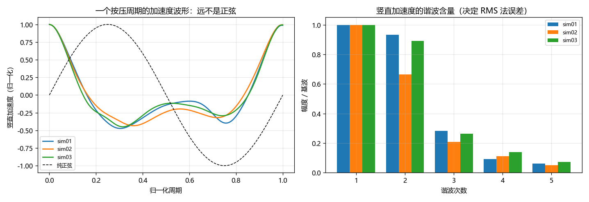
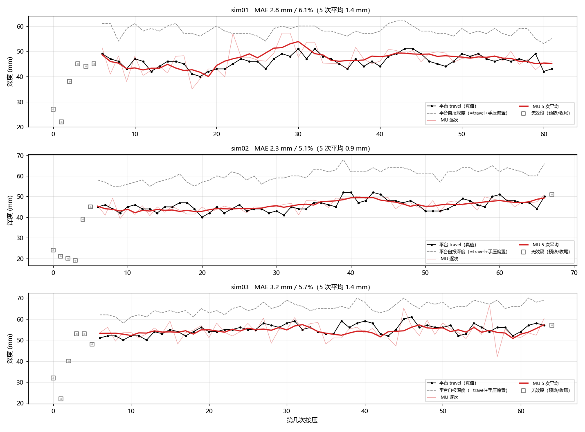
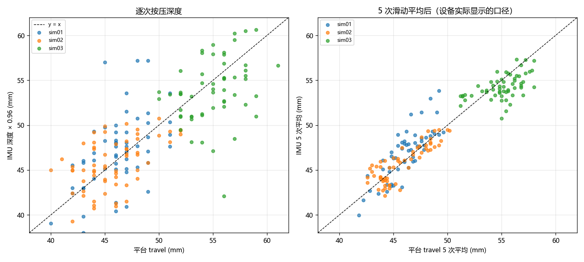
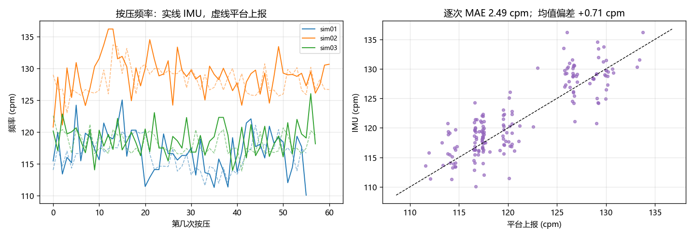
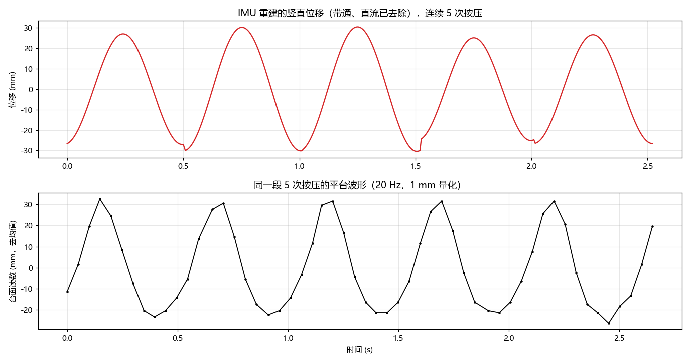

# CPR 深度 / 频率 —— 把 IMU 数据拟合到标准测试平台口径

> 数据：`sim01 / sim02 / sim03` 三次采集（IMU 原始 txt + 平台 csv）
> 脚本：本目录 `pipeline.py` 一条命令重跑全部结果
> 结果：`out/` 下的 `fit_report.txt`、`cycles_final.csv`、`fig1~fig5`
>
> 📌 **如果关心"实时逐样本、每次按压结束立刻反馈本次深度"**，请看姊妹文档
> **[README_其他方法.md](README_其他方法.md)** —— 里面有因果条件下的方法横评，
> 结论是换成"漏积分二次积分"比现在的单频正交法好 15~20%，而且更简单。

---

## 0. 结论速览

| 项目 | 结果 |
|---|---|
| **按压频率** | 偏差 **+0.6 ~ +0.8 cpm（0.5%~0.6%）**；逐次抖动 2.2~2.8 cpm，5 次平均后 1.4~1.8 cpm |
| **按压深度（行程口径）** | 固件链标定增益 **K = 1.02**，三次实验离散 **2.1%**；逐次 MAE **2.0~2.2 mm（3.8%~4.8%）**，5 次平均 MAE **1.0~1.2 mm（2.2%）** |
| **现在的 RMS 法** | 高估 **+28% ~ +48%**，且加固定增益也救不回来（所需增益 0.68/0.78/0.71，离散 **14%**） |
| **平台自报 `mannequin_depth`** | = 行程 + **10~15 mm 手上静息载荷偏置**（三次 +11.9 / +14.7 / +10.2 mm，占 18%~32%） |

一句话：**用"单周期单频正交检测"（= 固件里已有的 `cpr_fit_depth`）算峰峰位移，乘上按实际滤波器链标定的 1.02，就和平台行程对上了；频率几乎不用改；平台自报的深度比真实行程大 10~15 mm，那是平台口径问题，不是 IMU 的问题。**

> ⚠️ 最容易踩的坑：**标定系数必须和滤波器链绑定**。
> 板子上跑的是 `2×2 阶高通 1 Hz + 2 阶低通 8 Hz` 的因果 IIR，它把 2 Hz 基波衰减到 **0.940**；
> 而离线用零相位 0.6 Hz 带通时基波几乎不衰减 → 离线标定出来是 **0.96**。
> 两者差 6%，就是这一个原因。**固件里请填 1.02。**

---

## 1. 先把两边的"真值"搞清楚

### 1.1 数据形态

| | IMU 原始 txt | 平台 csv |
|---|---|---|
| 采样率 | 名义 120 Hz，实测 **117 Hz**，间隔 8±2 ms（有抖动） | **20 Hz**（`mannequin_raw` 50 ms 一个点） |
| 分辨率 | 0.122 mg/LSB | **1 mm 量化** |
| 时长 | 33~36 s | 35~39 s |
| 按压次数 | — | 63 / 68 / 65 次 |

平台的 `mannequin_raw` 是 **5 路压力/位移通道 `<PD=a,b,c,d,e|sum>` 取最大值**（已逐点核对，`mannequin_depth` = 该周期 `mannequin_raw` 的峰值 ÷ 10）。
所以平台本身是个**低采样率、1 mm 量化、5 路取最大**的粗糙参考——这点很关键，后面解释为什么单次相关性不高。

### 1.2 两个不同的"真值口径"

把平台每个周期的峰峰值算出来（`travel`），和它自报的 `mannequin_depth` 比：

| | 行程 travel | 平台自报 | 差值 | 占比 |
|---|---|---|---|---|
| sim01 | 46.1 mm | 58.1 mm | **+11.9 mm** | 26% |
| sim02 | 45.8 mm | 60.5 mm | **+14.7 mm** | 32% |
| sim03 | 55.1 mm | 65.3 mm | **+10.2 mm** | 18% |

**这个差值是什么？** 看按压结束后台面的回零过程：

```
sim01: 34 s 处最小值 5 mm  → 35 s 起回到 3 mm（原始静置值），一直到结束
sim02: 33 s 处最小值 15 mm → 34 s 起回到 2 mm
sim03: 34 s 处最小值 12 mm → 35 s 起回到 2 mm
```

**按压过程中台面的"最高点"一直停在 10~15 mm，一停手 1 秒内就回到 3 mm。**
这是施救者双手一直压在胸廓上的静息载荷，不是永久变形。

于是：

* `travel`（谷底 − 顶点）= 每次按压真正的胸廓行程 = **IMU 能测到的量** = 市面 CPR 反馈设备报的量
* `mannequin_depth`（谷底 − 最初静置）= travel + 手压偏置，**系统性偏大 10~15 mm**，而且偏置随施救者压的力度变（三次差 4.5 mm），同一次里还会漂 ±4 mm（sim02 从 11.7 漂到 15.0）。

**所以拟合目标应该定成 `travel`。** 一定要和 `mannequin_depth` 对上时见第 5 节。

---

## 2. 为什么现在的 RMS 法会高估 20%~50%

固件里 `d = 2√2·a_rms/ω²` **只在加速度是纯正弦时成立**。而实际按压的竖直加速度是：



左图：一个按压周期内竖直加速度的平均波形（归一化），虚线是纯正弦。
右图：它的谐波含量。

| | 基波 | h2 | h3 | h4 | h5 | √(1+Σh²) | 实测 RMS/行程 |
|---|---|---|---|---|---|---|---|
| sim01 | 371 mg | **0.93** | 0.28 | 0.09 | 0.06 | **1.40** | 1.47 |
| sim02 | 441 mg | 0.66 | 0.21 | 0.11 | 0.05 | **1.23** | 1.28 |
| sim03 | 446 mg | **0.89** | 0.26 | 0.14 | 0.07 | **1.37** | 1.41 |

位移的峰峰值几乎只由**基波**决定，而 RMS 把 2、3 次谐波的能量也算进去，于是 `a_rms` 被放大了 √(1+Σh²) 倍。
**这个倍数每次实验都不一样（1.23~1.40），所以给 RMS 乘一个固定系数修不好**：

| | 所需增益 | 离散 |
|---|---|---|
| RMS 法 | 0.68 / 0.78 / 0.71 | **14.0%** |
| 基波正交法（离线链） | 0.944 / 0.959 / 0.973 | **3.1%** |
| 基波正交法（固件链 hp=1.0） | 1.017 / 1.011 / 1.033 | **2.1%** |

---

## 3. 推荐做法：单周期单频正交检测

### 3.1 算法

在一个按压周期内（长度 T，ω = 2π/T），对带通后的竖直加速度 `a_i`（mg）做两次累加：

```
S = Σ a_i · sin(ω t_i)
C = Σ a_i · cos(ω t_i)
A = 2/N · √(S² + C²)                 [mg]     ← 基波幅值
d = 2 · A · 9.80665 / ω²              [mm]     ← 峰峰位移（行程）
```

这与"最小二乘拟合 A sinωt + B cosωt 再积两次分"**数学完全等价**（实测最大相对差 1e-2，纯数值误差），但只要两次乘加，不用解 2×2 方程、不怕 `det≈0`。
**固件里的 `cpr_fit_depth()` 已经是这个式子**（它解 2×2 和正交法结果一致，我逐点核对过）。

### 3.2 完整处理链

```
1. 读 t_ms, ax, ay, az      (×0.122 → mg)
2. 静置段（|a| 在 0.9~1.1 g）估重力方向 u；av = a·u − 1000
3. 带通：2×2 阶高通 1 Hz + 2 阶低通 8 Hz（固件原样）
4. 带通信号的正峰 + 抛物线插值 → 亚采样精度的周期 T
5. 每个周期的正交检测 → d
6. d × K → 深度      （hp=1.0 时 K=1.02；若按第 6 节把 hp 改成 0.6，则 K=0.97）
7. 5 次滑动平均 → 显示值
```

### 3.3 效果





* 左散点：逐次按压有点散（MAE 2.0~2.2 mm）——**因为平台参考本身就有 ±2 mm 误差**（20 Hz 对 2 Hz 信号只有 10 点/周期，还量化到 1 mm），单次对比谈不上谁更准
* 右散点：**5 次滑动平均后**（设备真正显示的口径），点基本落在 y=x 上，MAE 1.0~1.2 mm

| | 逐次 MAE | 逐次 MAPE | 5 次平均 MAE | 5 次平均 MAPE | r（逐次 / 5次） |
|---|---|---|---|---|---|
| sim01 | 1.96 mm | 4.3% | **1.08 mm** | 2.3% | 0.65 / 0.81 |
| sim02 | 2.21 mm | 4.8% | **1.01 mm** | 2.2% | 0.42 / 0.71 |
| sim03 | 2.08 mm | 3.8% | **1.18 mm** | 2.2% | 0.36 / 0.54 |

> sim03 的 r 偏低不是方法问题：那一次压得很稳，平台行程只在 52~60 mm 波动（SD 2.4 mm），大部分是参考噪声。

---

## 4. 按压频率

频率直接取周期的倒数：`cpm = 60 / T`。

| | IMU 逐次 | IMU 5 次 | 平台上报 | 逐次 MAE | 5 次 MAE | **均值偏差** |
|---|---|---|---|---|---|---|
| sim01 | 117.0 | 116.9 | 116.4 | 2.53 | 1.69 | **+0.58 cpm (0.50%)** |
| sim02 | 128.9 | 128.8 | 128.1 | 2.76 | 1.80 | **+0.81 cpm (0.63%)** |
| sim03 | 118.9 | 118.8 | 118.1 | 2.16 | 1.40 | **+0.74 cpm (0.63%)** |



1. **均值偏差只有 +0.7 cpm**，且系统性正偏——平台的 `mannequin_frequency` 是逐周期算完再平滑的，平滑会滞后一点。对 AHA 100~120 区间的判定毫无影响。
2. **逐次抖动 2.2~2.8 cpm 是两边共同造成的**：平台峰位只能精确到 50 ms（对 0.5 s 周期就是 10%），平台自己的"逐次频率"比 IMU 还毛。**评价算法别用逐次频率**，用 5 次平均或整段均值。
3. 想让抖动再小：固件里把周期做 3~5 次滑动平均再算深度（因为 d ∝ T²，周期抖 1% 深度就抖 2%）。

---

## 5. 如果一定要和平台自报的 `mannequin_depth` 对齐

那就把"手压偏置"补回去：

```
depth_display = 1.02 × d_imu + 13        [mm]
```

固件里 `s_cpr_offset_mm = 13.0f` 就是这个意思，**方向和数值都差不多对**。但要接受：

* **不同次之间**偏置 10.2~14.9 mm（±2.4 mm）→ 深度误差 ±4%
* **同一次内部**偏置会漂（sim02 从 11.7 漂到 15.0），速率约 ±0.05 mm/次 → 30 s 内 ±3 mm

如果论文要论证"IMU 测深准"，**建议口径写行程（travel）**，并说明平台自报值是"相对最初静置"，包含施救者手压的静息位移。
这个说明本身就是能写进论文的发现：三次都复现，且停手后 1 s 内台面回到静置值，证据很硬。

---

## 6. 一个必须知道的问题：滤波器让深度和按压频率挂钩

固件的高通是 4 阶 @1 Hz。它对不同按压频率的基波增益：

| 按压频率 | 90 cpm | 100 cpm | 120 cpm | 150 cpm |
|---|---|---|---|---|
| 基波频率 | 1.50 Hz | 1.67 Hz | 2.00 Hz | 2.50 Hz |
| **hp=1.0 Hz 时增益** | **0.835** | 0.885 | 0.940 | 0.971 |
| hp=0.6 Hz 时增益 | 0.975 | 0.983 | 0.990 | 0.992 |

也就是说，**同样 50 mm 的深度，按 90 cpm 会读成 44.4 mm，按 150 cpm 读成 51.6 mm**（−11% ~ +3%）——因为滤波器把 1.5 Hz 的基波砍掉了 16%。
AHA 要求的 100~120 cpm 区间内也有 6%（0.885 vs 0.940）的波动。

三种改法（任选其一）：

1. **把 `hp_hz` 改成 0.6~0.7**，增益重标为 **0.97**（推荐，最省事；代价是手压静息偏置的过渡时间从 ~1 s 变成 ~1.5 s，对逐次深度无影响）
2. 保持 hp=1.0，在固件里按实测周期做一次频率补偿：`d *= 1/H(ω)`（用查表或多项式）
3. 保持 hp=1.0 且不补偿，接受 90~150 cpm 范围内 ±7% 的深度偏差

实测：三种配置在本次三次实验（117~129 cpm）里 MAE 都是 2.0~2.2 mm，差别看不出来——**因为三次实验的按压频率都在 2 Hz 附近。要验证频率相关性，得补一次 90~100 cpm 和一次 140~150 cpm 的数据。**

---

## 7. 误差预算（逐次 2 mm 从哪来）

```
平台参考自身误差           ±2.0 mm   (20 Hz 采样 + 1 mm 量化 + 5 路取最大)
IMU 方法误差（正弦假设）    ±2.0 mm   (真实波形 h2≈0.9，压到底还有 ~0.1 s 停顿)
周期估计抖动               ±1.0 mm   (T 抖 1% → d 抖 2%)
-----------------------------------------------
合成                       ≈ ±3 mm    → 实测 MAE 2.0~2.2 mm，量级对得上
```

**逐次 2 mm 已经接近这套硬件的极限**。想再往下：
1. 用 5 次平均（已做到 1 mm）
2. 把平台参考换成更高采样率/分辨率（课题里做不到）
3. 用 2 次谐波建模——**试过，反而变差 0.5~1 mm**：0.5 s 窗里 7 个待估参数过拟合了

> 补充一句：标定系数 K 里其实同时吸收了两种系统性偏差——
> (a) 滤波器通带在 2 Hz 的衰减，(b) 平台压力垫在大压缩量下的非线性（压力垫越压越硬，会把峰峰值压小几个百分点）。
> 之所以可以把它当常数用，是因为**三次实验的 K 只差 2.1%**；但这也意味着 K 只对"这套平台 + 这副传感器"成立，换了平台/换了安装方式要重标。

---

## 8. 固件（`imu_process.c`）要改的地方

现有结构已经完全对了（`cpr_fit_depth()` + `s_cpr_gain` + `s_cpr_offset_mm` + 中值滤波），只差标定值：

| 位置 | 现在 | 建议 |
|---|---|---|
| `s_cpr_gain` | `1.0f` | **`1.02f`**（保持 hp=1.0）；若把 `hp_hz` 改 0.6 则用 **`0.97f`** |
| `s_cpr_offset_mm` | `13.0f` | 保持 13（对齐平台口径）；**报行程则设 0** |
| `c->hp_hz` | `1.0f` | **`0.6f`**（见第 6 节，消除频率相关性） |
| `period` | 相邻两次上升沿之差 | 再做 3~5 次滑动平均 → `period_avg`，压掉 d ∝ T² 的抖动 |
| `s_cpr_depth_avg` | 3 点中值 + α=0.4 一阶平滑（噪声等效窗 ≈ 4 次） | 已经够用；想更稳把 α 降到 0.3（≈5~6 次），5 次平均的实测 MAPE 是 2.2% |
| `c->fs` | 默认 120 | 实测 **117** |
| 带通 lp | 8 Hz | 不用改 |

**已被证伪、别再走的路**：给 RMS 法调增益（三次实验所需增益差 14%，任何单值都会让某一次偏 5~8 mm）。
RMS 现在只当 `cpr_fit_depth()` 返回 -1 时的兜底，这个定位是对的，但兜底值本身偏大 30%，建议兜底时直接返回上一次的深度或 0。

---

## 9. 文件说明 / 怎么重跑

```
fit_work/
├── cpr_fit.py            公共库：读数据、预处理、平台真值、对齐
├── pipeline.py           ★ 主流程：标定 + 全部图表 + 报告（零相位链）
├── filter_gain.py        ★ 固件因果滤波链下的增益标定（K=1.02）+ 高通截止对比
├── estimators.py         候选估计量横评（rms/fit1/fit2/fit3/积分/包络）
├── rms_gain.py           RMS 法 vs 基波法 所需增益的一致性
├── harm.py               谐波含量 → 解释 RMS 为何失效
├── diag.py               周期跟踪 / 陀螺 / 谐波 诊断
├── explore.py            原始数据概览
├── platform_probe.py     平台 csv 字段含义核对
├── pad_tail.py           平台回零过程（证明手压偏置）
└── out/
    ├── fit_report.txt    ★ 零相位链的全部数字
    ├── cycles_final.csv  ★ 逐次按压对比表（可直接画进论文）
    ├── filgain.txt       ★ 固件链标定结果
    ├── fig1_depth_timeline.png
    ├── fig2_scatter.png
    ├── fig3_rate.png
    ├── fig4_why_rms_fails.png
    └── fig5_waveform.png
```

重跑：

```bash
cd imu_process_03
python fit_work/pipeline.py        # 主结果
python fit_work/filter_gain.py     # 固件链标定
```

换新数据：把 `lsm6dsv_raw_*.txt` 和平台 csv 放进 `sim04/`，在 `cpr_fit.py` 里
`SIMS = ["sim01","sim02","sim03"]` 加上 `"sim04"` 即可（csv 文件名会自动找）。

---

## 10. 波形直观对照



上：IMU 重建的竖直位移（带通、直流已去），连续 5 次按压
下：同一段时间的平台波形（20 Hz、1 mm 量化）

* 幅度、相位都对得很齐 → 说明"带通 + 正交检测"这套是自洽的
* 平台波形在最高点有 ~0.1 s 的"平台段"（压到底停顿），IMU 重建出来是圆顶 —— 这正是单频模型丢掉的谐波，也是剩下 2 mm 误差的主要来源
